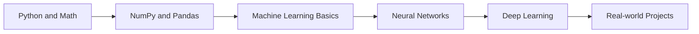

<div align="center">
  
</div>

<div align="center">
  
</div>

<br>

<div align="center">
  
  <br><br>
  
</div>

<div align="center">


</div>

---

## 🧠 About Me

I'm an Information Technology undergraduate at the **University of Moratuwa** who loves building full-stack products and, lately, going deep into **AI and neural networks**. I enjoy understanding how models actually learn, from the maths behind backpropagation to shipping a trained model inside a real application.

```python
import torch.nn as nn

class Navoda(nn.Module):
    def __init__(self):
        super().__init__()
        self.education = "BSc (Hons) IT @ University of Moratuwa"
        self.current_focus = ["Neural Networks", "Deep Learning", "Machine Learning"]
        self.web_stack = ["Next.js", "Tailwind CSS", "Spring Boot", "MySQL"]
        self.portfolio = "https://navoda.dev"
        self.motto = "Learn. Train. Iterate. Ship."

    def forward(self, curiosity):
        return curiosity.learn().build().deploy()
```

---

## 🔭 What I'm Up To

| | |
|---|---|
| 🤖 **Currently learning** | Neural networks, deep learning, and ML fundamentals |
| 🛠️ **Building** | Full-stack apps, with a growing interest in adding AI features |
| 🌐 **Portfolio** | [navoda.dev](https://navoda.dev/) |
| 💬 **Ask me about** | Java, C, React, Next.js, MySQL, and getting started with neural networks |
| 📫 **Reach me** | [navodachathurya2001@gmail.com](mailto:navodachathurya2001@gmail.com) |

---

## 🗺️ AI/ML Learning Path



- [x] Python, NumPy and Pandas fundamentals
- [x] Core ML concepts (regression, classification, evaluation)
- [ ] 🧠 Neural networks from scratch (forward pass, backprop, gradient descent)
- [ ] 🧠 CNNs and computer vision
- [ ] 🧠 Deploying trained models behind a web API

> Tick these off as you go and update the list. It keeps your profile honest and current.

---

## 🛠️ Tech Stack

### 🧠 AI / Machine Learning
<div align="center">


</div>

### 🌐 Full Stack Development
<div align="center">


</div>

### 🗄️ Databases & Tools
<div align="center">


</div>

---

## 📊 GitHub Stats

<div align="center">
  
  
</div>

<div align="center">
  
</div>

<div align="center">
  
</div>

---

## 🤝 Let's Connect

<div align="center">

[](https://www.linkedin.com/in/navodachathurya/)
[](https://navoda.dev/)
[](mailto:navodachathurya2001@gmail.com)
[](https://stackoverflow.com/users/23432853/navoda-chathurya)
[](https://www.instagram.com/navoda_c001/)
[](https://fb.com/seeeeeeker)

</div>

<br>

<div align="center">
  
</div>
